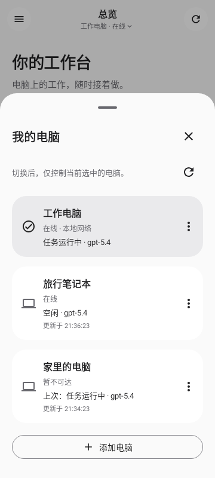
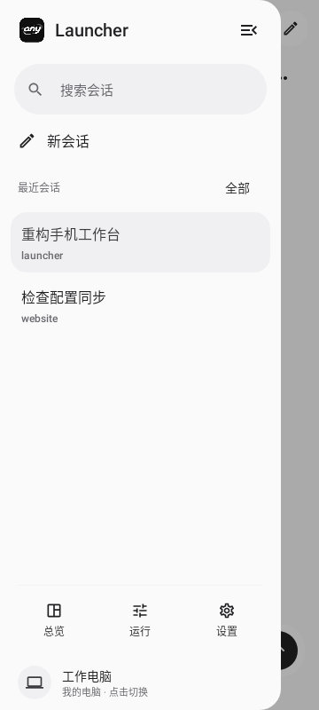
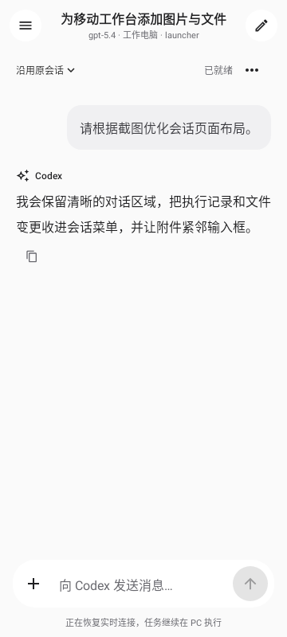
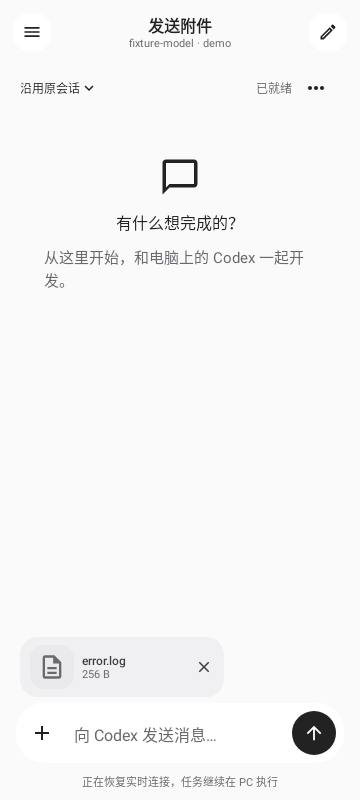
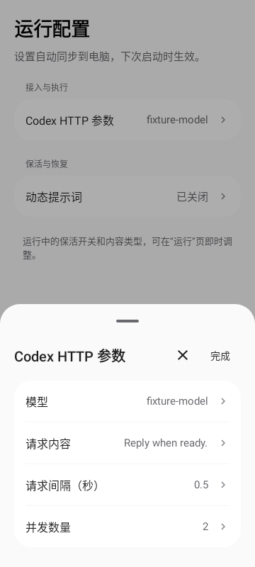

# Launcher Mobile

A native Android control center for your paired development PCs, built with Kotlin and Jetpack Compose. Requires Android 8.0 or later.

The original Launcher icon is retained. The interface uses a neutral iOS-inspired theme, a searchable conversation sidebar, grouped settings, and a floating composer. Light/dark themes, native animations, large text, and live updates are supported.

<p>
  
  
  
  
  
</p>

Screenshots are rendered from the native Compose UI using synthetic test data. See the [interface guide](docs/interface.md) for navigation, continuation rules, and configuration behavior.

## Features

- **My computers:** save up to 16 PCs, switch the active destination, see individual connectivity and run summaries, and edit local names or alternate addresses. Credentials are encrypted; the original single-PC record migrates automatically.
- **Connectivity:** independent heartbeat and event transports, bounded read retries, authenticated LAN/Tailscale failover, recent conversation caches, and separate connection/loading feedback.
- **Overview:** PC connectivity, ANY acquisition and keep-alive status, pending approvals, and recent sessions.
- **Workbench:** conversation-first layout, current model, session naming and renaming, pull-down history loading, a searchable sidebar, original-session or branch selection, AI replies, execution records and file changes in the session menu, steering, interruption, and supported Codex approvals.
- **Attachments:** system photo/file pickers, camera import, private per-session drafts, resumable uploads, pure image/file messages, image previews, bounded text reading, and attachment history across branches. See [attachments](docs/attachments.md) for limits and supported content.
- **Run:** start/stop, the PC's resolved model name, immediate keep-alive controls, request/response details, searchable logs, and revision-checked PC configuration.
- **Settings:** providers, usage, billing, Windows scheduled tasks, maintenance jobs, credentials, workbench connections, appearance, and verified APK updates.

Only the Android client, public protocol documentation, release automation, and update Worker are included. Desktop implementation and credentials remain private.

## Connect

1. Run Launcher desktop **2.8.0-beta.3 or later** for automatic LAN/Tailscale listeners and connection alternatives. Beta.2 retains attachments and resolved run models; beta.1 retains text conversations and existing controls.
2. Enable mobile connections on a LAN or Tailscale IPv4 address.
3. Grant full management access for configuration and workbench controls.
4. Scan the one-time QR code or paste its payload into the app.
5. Tap the computer name or open **Settings → My computers** to add another PC and switch between them. Each PC needs its own pairing.

The original v1 pairing protocol is retained: HTTPS, an exact certificate fingerprint, one-use pairing tokens, expiring device credentials, and Android Keystore storage. Devices without control permission can view the original run dashboard only. Older PCs can still provide v1 run status and controls.

The PC and Launcher must remain running. Disconnecting the phone does not cancel PC tasks. Development tools execute on the PC.

On a shared Wi-Fi network or phone hotspot, a reachable local address can avoid a relayed Tailscale path. On other networks, Tailscale must be online on both devices. If the original address is already unreachable, enter an address shown on the PC's connection page under **My computers → Edit name and address**, or pair again using that address. See [multiple computers and connectivity](docs/computers.md).

## Session compatibility

The desktop gateway uses the official Codex App Server protocol. It attempts a shared local backend first and can fall back to a managed stdio server. The PC keeps its configured provider and permissions.

- Managed sessions support bidirectional control.
- Sessions loaded by an accessible shared backend can be attached.
- Reading an independently running Desktop/CLI session's history does not imply live control. These sessions are marked read-only and can be branched into a new managed session.
- The continuation sheet always exposes both choices. Original-session control stays disabled with an explanation when the gateway cannot attach; it is never silently replaced with a fork.
- CODEX_HOME, the executable, project path, and shared socket are configurable.
- An old session may require restoring its original provider before it can continue.

Submitted messages are reconciled using stable message IDs. Text/file drafts and pending submissions are stored in private app storage, separated by the paired PC, backend scope, and conversation. Uploads pause in the background and can be resumed manually. Long-context compaction and temporary upstream retries have separate progress indicators. Unconfirmed model commands are never automatically replayed with a new request ID, including after process restart.

## Build

Use JDK 21, Android SDK 35, and Build Tools 35.0.0:

```sh
./gradlew :app:assembleDebug :app:testDebugUnitTest :app:lintDebug
node --test update-worker/test/*.test.js
```

On Windows use `gradlew.bat` and an ASCII-only checkout path for reliable Robolectric discovery. Set `ANDROID_HOME` or an untracked `local.properties`. The wrapper verifies its Gradle distribution checksum. Real Compose screenshots are generated in `app/build/reports/mobile-ui/`.

## Release

**Release APK** builds a signed APK and signed update manifest. The `vVERSION` tag must match `versionName`; increment `versionCode` for every published update. Manual runs produce artifacts without publishing a release.

| Actions secret | Value |
| --- | --- |
| `ANDROID_KEYSTORE_BASE64` | Base64 production keystore |
| `ANDROID_KEYSTORE_PASSWORD` | Keystore/key password |
| `UPDATE_SIGNING_KEY` | Base64 PKCS#8 DER EC P-256 private key |

The keystore alias is `launcher`. Keep this certificate for in-place APK updates. The manifest private key must match `release/update-public-key.txt`; the release script checks this. Back up private material securely outside Git. Moving from a debug APK to the first production APK may require a one-time uninstall/reinstall.

The three signing secrets above are sufficient for APK releases. The optional **Deploy Update Worker** workflow additionally needs `CLOUDFLARE_API_TOKEN` and `CLOUDFLARE_ACCOUNT_ID`. It runs manually, or on Worker changes after setting `CLOUDFLARE_DEPLOY_ENABLED=true`. Once the Worker is deployed, routine APK releases need no Cloudflare credentials: it reads GitHub Releases automatically.

## Update Worker

`https://launcher.laogaohohoho.me/v1/android/stable` serves signed metadata from GitHub Releases. APKs are hosted on GitHub. This public Worker does not expose PC control.

The client verifies the ECDSA manifest signature, download size, SHA-256, APK package name, version, and signing certificate before invoking Android's installer. Installation always uses Android's user confirmation.

```sh
cd update-worker
npm ci
npm test
npx wrangler login
npm run deploy
```

Authenticate to the Cloudflare account owning the domain. Configure the Cloudflare Actions secrets before running **Deploy Update Worker**. See [protocol documentation](docs/protocol.md) and [release operations](docs/releases.md).

## License

MIT. Dependencies retain their respective licenses. The UI uses native Jetpack Compose / Material 3, Markwon for Markdown replies, and ZXing Embedded for QR scanning; no AGPL application source is included.
