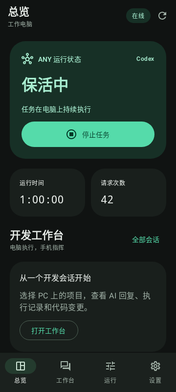
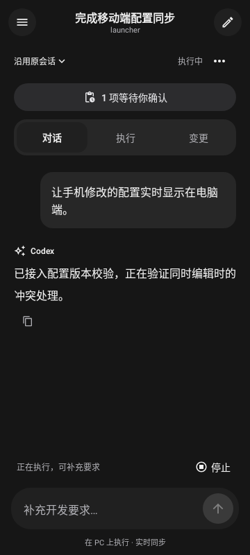
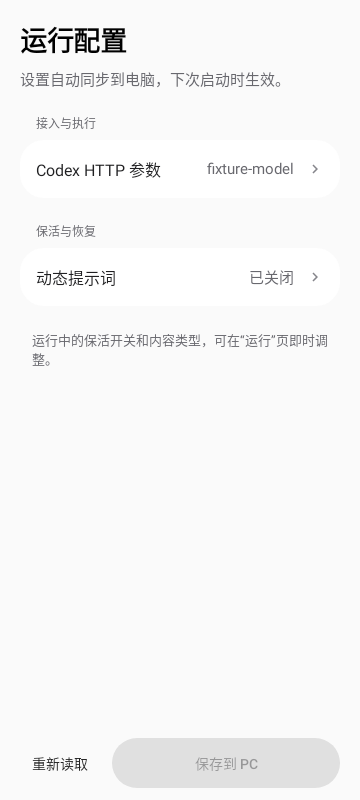

# Launcher Mobile

A native Android control center for a paired development PC, built with Kotlin, Jetpack Compose, and Material 3. Requires Android 8.0 or later.

The original Launcher icon is retained. The interface supports light and dark themes, animated navigation, large text, and live updates.

<p>
  
  
  
</p>

Screenshots are rendered from the native Compose UI using synthetic test data.

## Features

- **Overview:** PC connectivity, ANY acquisition and keep-alive status, pending approvals, and recent sessions.
- **Workbench:** project/session browsing, AI replies, command output, file changes, follow-up messages, steering, interruption, and supported Codex approvals.
- **Run:** start/stop, immediate keep-alive controls, request/response details, searchable logs, and revision-checked PC configuration.
- **Settings:** providers, usage, billing, Windows scheduled tasks, maintenance jobs, credentials, workbench connections, appearance, and verified APK updates.

Only the Android client, public protocol documentation, release automation, and update Worker are included. Desktop implementation and credentials remain private.

## Connect

1. Run Launcher desktop **2.8.0-beta.1 or later** with companion API v2.
2. Enable mobile connections on a LAN or Tailscale IPv4 address.
3. Grant full management access for configuration and workbench controls.
4. Scan the one-time QR code or paste its payload into the app.

The original v1 pairing protocol is retained: HTTPS, an exact certificate fingerprint, one-use pairing tokens, expiring device credentials, and Android Keystore storage. Devices without control permission can view the original run dashboard only. Older PCs can still provide v1 run status and controls.

The PC and Launcher must remain running. Disconnecting the phone does not cancel PC tasks. Development tools execute on the PC.

## Session compatibility

The desktop gateway uses the official Codex App Server protocol. It attempts a shared local backend first and can fall back to a managed stdio server. The PC keeps its configured provider and permissions.

- Managed sessions support bidirectional control.
- Sessions loaded by an accessible shared backend can be attached.
- Reading an independently running Desktop/CLI session's history does not imply live control. These sessions are marked read-only and can be branched into a new managed session.
- CODEX_HOME, the executable, project path, and shared socket are configurable.
- An old session may require restoring its original provider before it can continue.

Submitted messages are displayed immediately and reconciled using the server's client message ID. Pending text stays visible across refreshes, navigation, and background/foreground transitions while this app process remains alive. Long-context compaction and temporary upstream retries have separate progress indicators; a retry does not mean the turn has failed. Unconfirmed commands are never automatically replayed with a new request ID.

## Build

Use JDK 21, Android SDK 35, and Build Tools 35.0.0:

```sh
./gradlew :app:assembleDebug :app:testDebugUnitTest :app:lintDebug
node --test update-worker/test/*.test.js
```

On Windows use `gradlew.bat` and an ASCII-only checkout path for reliable Robolectric discovery. Set `ANDROID_HOME` or an untracked `local.properties`. The wrapper verifies its Gradle distribution checksum. Real Compose screenshots are generated in `app/build/reports/mobile-ui/`.

## Release

**Release APK** builds a signed APK and signed update manifest. The `vVERSION` tag must match `versionName`; increment `versionCode` for every published update. Manual runs produce artifacts without publishing a release.

| Actions secret | Value |
| --- | --- |
| `ANDROID_KEYSTORE_BASE64` | Base64 production keystore |
| `ANDROID_KEYSTORE_PASSWORD` | Keystore/key password |
| `UPDATE_SIGNING_KEY` | Base64 PKCS#8 DER EC P-256 private key |

The keystore alias is `launcher`. Keep this certificate for in-place APK updates. The manifest private key must match `release/update-public-key.txt`; the release script checks this. Back up private material securely outside Git. Moving from a debug APK to the first production APK may require a one-time uninstall/reinstall.

The three signing secrets above are sufficient for APK releases. The optional **Deploy Update Worker** workflow additionally needs `CLOUDFLARE_API_TOKEN` and `CLOUDFLARE_ACCOUNT_ID`. It runs manually, or on Worker changes after setting `CLOUDFLARE_DEPLOY_ENABLED=true`. Once the Worker is deployed, routine APK releases need no Cloudflare credentials: it reads GitHub Releases automatically.

## Update Worker

`https://launcher.laogaohohoho.me/v1/android/stable` serves signed metadata from GitHub Releases. APKs are hosted on GitHub. This public Worker does not expose PC control.

The client verifies the ECDSA manifest signature, download size, SHA-256, APK package name, version, and signing certificate before invoking Android's installer. Installation always uses Android's user confirmation.

```sh
cd update-worker
npm ci
npm test
npx wrangler login
npm run deploy
```

Authenticate to the Cloudflare account owning the domain. Configure the Cloudflare Actions secrets before running **Deploy Update Worker**. See [protocol documentation](docs/protocol.md) and [release operations](docs/releases.md).

## License

MIT. Dependencies retain their respective licenses. The UI uses native Jetpack Compose / Material 3, Markwon for Markdown replies, and ZXing Embedded for QR scanning; no AGPL application source is included.
